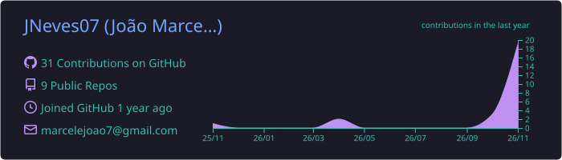
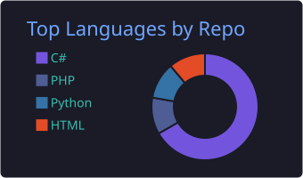
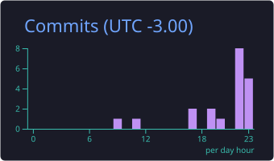
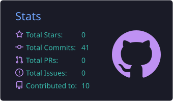
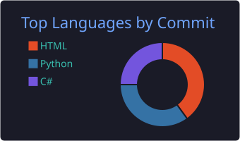

<div align="center">


[](https://git.io/typing-svg)

[](https://jneves07.github.io)
[](https://www.linkedin.com/in/joao-marcele-a30407336/)
[](mailto:marcelejoao7@gmail.com)
[](https://wa.me/5599981897798)

</div>

---

## 🎯 Sobre mim

<table>
<tr>
<td width="62%">

```js
const joao = {
  role: "Engenheiro de Software",
  focus: "Desenvolvedor Back-End",
  location: "Caxias, MA - Brasil 🇧🇷",

  working: {
    at: "Fábrica de Software - UniFacema",
    on: ["Sistemas institucionais",
         "Controle e análise de dados"],
  },

  studying: [
    "Engenharia de Software (7º período)",
    "Análise e Desenv. de Sistemas (4º)",
  ],

  learning: ["TypeScript", "Python p/ dados", "IoT"],

  languages: ["PT 🇧🇷", "EN B1", "ES B1", "Libras"],

  lookingFor: "Estágio em desenvolvimento",
};
```

</td>
<td align="center" width="38%">

[](https://github.com/JNeves07)

</td>
</tr>
</table>

> 💬 *"Qualquer tolo escreve código que um computador entende. Bons programadores escrevem código que humanos entendem."* — **Martin Fowler**

> 🎓 Antes de programar, fui **redator e professor**. Por isso gosto de código claro e de explicar soluções técnicas de um jeito que todo mundo entende.

---

## 🛠️ Tech Stack

<div align="center">


</div>

---

## 🚀 Projetos em destaque

| Projeto | Descrição | Tecnologias |
|---|---|---|
| **[Sistema-Academico](https://github.com/JNeves07/Sistema-Academico)** | Descreva aqui o que o sistema faz | `Tecnologia` `Tecnologia` |
| **[pokedex](https://github.com/JNeves07/pokedex)** | Descreva aqui o que o projeto faz | `Tecnologia` `Tecnologia` |
| **[Programa-o-em-Banco-de-dados](https://github.com/JNeves07/Programa-o-em-Banco-de-dados)** | Descreva aqui o que o projeto faz | `SQL` `Tecnologia` |

---

## 📊 GitHub Analytics

<div align="center">









</div>

---

<div align="center">


</div>
